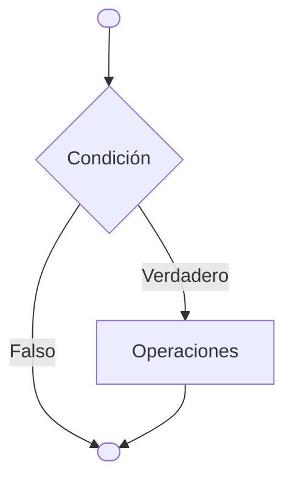
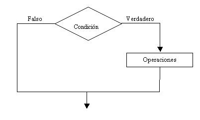
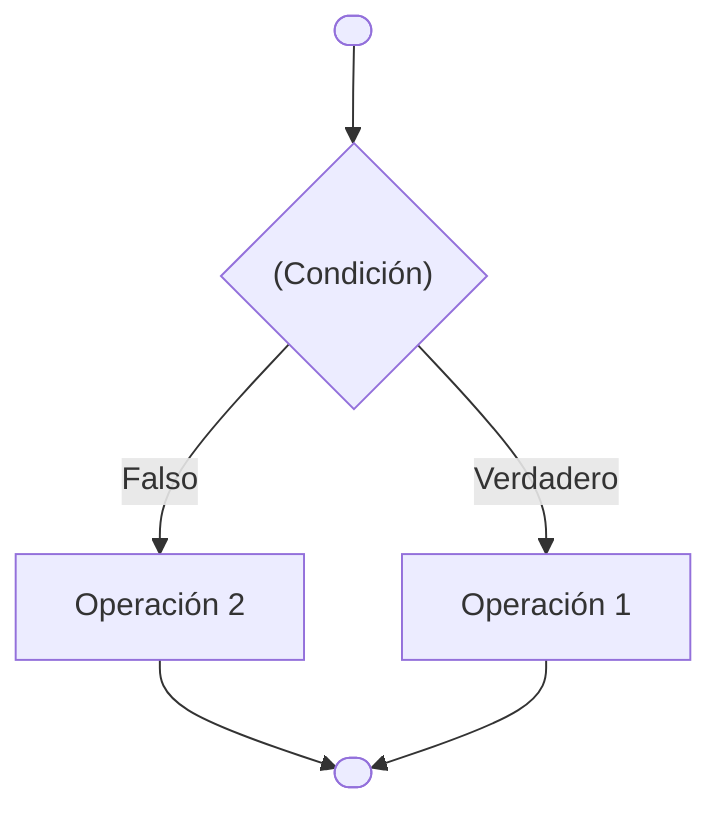
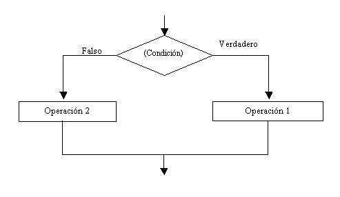

## 4.1 Condicionales Simples y Compuestos

Los condicionales simples y compuestos, permiten **tomar decisiones** en función de si una condición es verdadera o falsa.

## Estructura Condicional Simple

En este tipo de estructuras tenemos la opción de **realizar una actividad** o **no realizar ninguna**.





El esquema básico de este tipo de estructuras es el siguiente:
```python
if condition:
    # code
```

## Estructura Condicional Compuesta.

En este otro tipo de estructuras tenemos la tenemos la opción de **realizar una actividad u otra**. Es decir tenemos actividades por el verdadero y por el falso de la condición. En este caso, **nunca** se realizan las actividades de las dos ramas.





El esquema básico de este tipo de estructuras sería el siguiente:
```python
if condition:
    # code
else:
    # code
```
