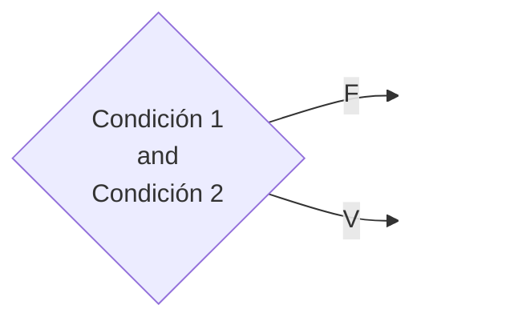

## 4.3 Estructuras Condicionales Compuestas con operadores lógicos

Hasta ahora hemos visto operadores:

- Relacionales: >, <, >=, <= , ==, !=
- Matemáticos: +, -, \*, /, //, \*\*, %

Pero faltan otros operadores imprescindibles:

- Lógicos: _and_ y _or_

Estos dos operadores **agrupan varias condiciones simples**.



Si la condición 1 **Y** la condición 2 son verdaderas, se ejecuta la rama del verdadero.

El uso de operadores lógicos permite en muchos casos plantear algoritmos más cortos y comprensibles.

Un ejemplo de este tipo de condicionales es el siguiente:

```python
if nombre == "admin" and passw == "1234" and edad >= 18:
    print("Acceso concedido. ¡Bienvenido!")
elif edad < 18:
    print("Acceso denegado. Debes ser mayor de edad.")
else:
    print("Acceso denegado. Nombre de usuario o contraseña incorrectos.")
```
