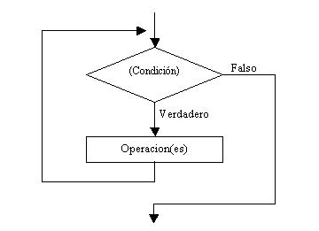
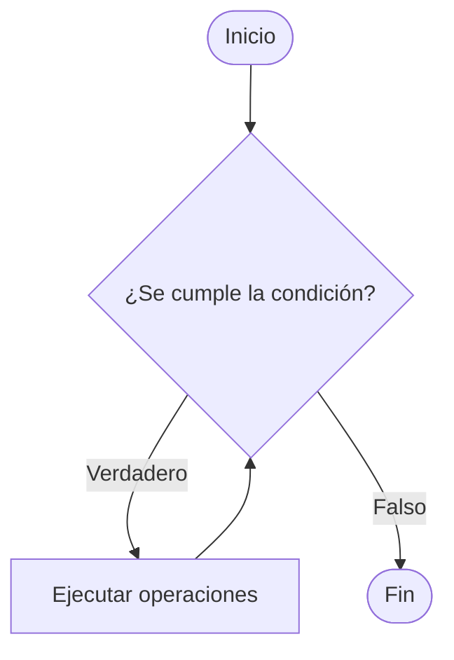

## 5.1 Estructura Repetitiva *WHILE*.

Esta estructura, repite el código contenido en ella **mientras** la condición sea verdadera.

> [!IMPORTANT]  
> Si la condición es siempre verdadera estamos en presencia de un **bucle infinito**. Dicha situación suele ser un **error**, ya que nunca finalizará el programa.





El código esquemático para el bucle while, sería el siguiente:

```python
while condition:
```