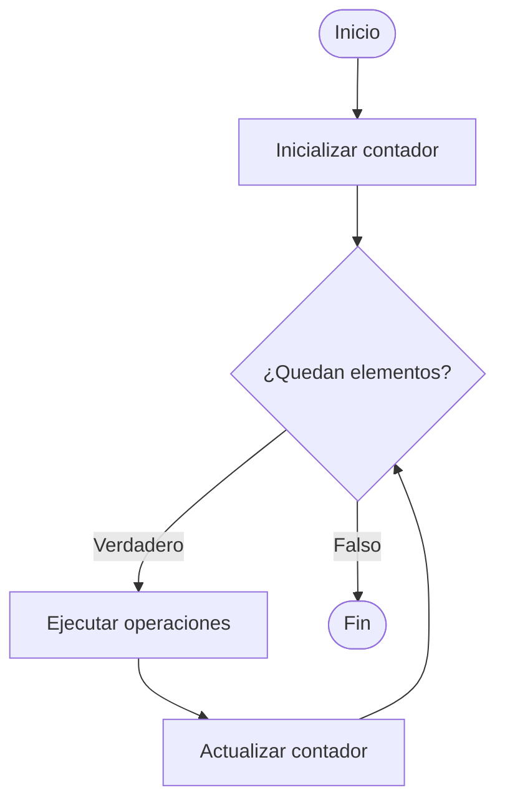

# 5.1 Estructura Repetitiva *FOR*.

Cualquier problema que requiera un bucle se puede resolver con un while, pero hay otra estructura repetitiva más sencilla en situaciones en que haya que recorrer una **lista de datos**.

En estos casos utilizaremos, generalmente, el **bucle for**, y este es su diagrama de flujo:



El código esquemático para el bucle for, sería el siguiente:

```python
for i in range(10):
```

Siendo *i* la variable conocida como **iterador** y `range()` el número de veces que deseamos repetir el código.